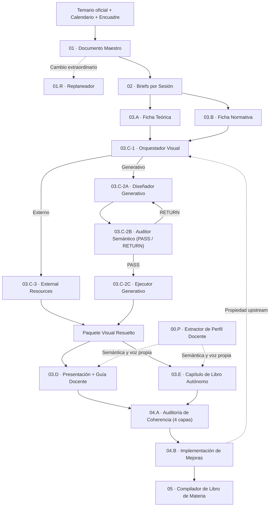

<div align="center">


# Flujo de Diseño de Cursos

**Ecosistema abierto de Agent Skills y Orquestación Autónoma —aplicable a cualquier grado académico, disciplina y modalidad— para transformar un temario oficial en un sistema didáctico completo, trazable y auditable.**

[](CHANGELOG.md)
[](#-qué-es)
[](manifest.yaml)
[](agents/orquestador-curso.md)
[](LICENSE)
[](CONTRIBUTING.md)

[¿Qué es?](#-qué-es) • [¿Qué produce?](#-qué-hace-entregables) • [¿Cómo funciona?](#-cómo-lo-hace) • [Mapa de Skills](#-mapa-del-ecosistema) • [Inicio Rápido](#-cómo-empezar) • [Contribuir](#-contribuir)

</div>

---

## ¿Qué es?

**Flujo de Diseño de Cursos** es una arquitectura modular de **Agent Skills** (`SKILL.md`) y un **Agente Orquestador** diseñada para docentes, diseñadores instruccionales y equipos académicos que utilizan inteligencia artificial para planear, producir y auditar cursos completos.

En lugar de depender de un solo prompt gigante o de chats aislados que pierden coherencia entre sesiones, este proyecto divide el diseño instruccional en **etapas especializadas conectadas por contratos explícitos**, igual que un pipeline de ingeniería de software: cada etapa tiene entradas definidas, reglas estrictas, salidas verificables y propiedad clara sobre lo que puede o no modificar.

El sistema fue diseñado desde su origen para **aplicarse a cualquier grado académico** (educación básica, media superior, técnico superior, licenciatura, ingeniería, posgrado o formación continua), **cualquier disciplina** y **cualquier modalidad** (presencial, híbrida o en línea). Su etapa de auditoría (`04.A`) verifica específicamente que la profundidad real del contenido coincida con el nivel académico declarado, mientras que los perfiles en [`profiles/`](profiles/template-perfil-estilo.md) garantizan que los materiales se redacten **usando la semántica, terminología y voz propia del docente**, evitando textos genéricos de IA. Además, es compatible tanto con herramientas de agentes (Antigravity, Claude Code, Cursor, Gemini CLI, Codex) como con uso manual paso a paso en cualquier chat de IA.

---

## ¿Qué hace? (Entregables)

A partir de un **temario oficial**, un **calendario académico** y el **encuadre docente**, el ecosistema es capaz de construir y mantener sincronizados todos los artefactos de una asignatura:

| Etapa | Qué produce |
|---|---|
| **Perfil semántico docente** | **Perfil de estilo y semántica propia** (`00.P`) extraído desde corpus real, entrevista guiada o consolidación, que alimenta a `03.D`, `03.E` y `04.B`. |
| **Planeación curricular** | **Documento Maestro del Curso** (ponderación temática, actividades oficiales con IDs estables, matriz de trazabilidad de competencias y calendario completo) + **Replaneación extraordinaria** ante cambios de calendario. |
| **Diseño por sesión** | **Briefs contractuales por sesión** que fijan alcance, prerrequisitos, pesos por subtema y actividades vinculadas. |
| **Desarrollo disciplinar** | **Ficha Teórica** (conceptos clasificados por nivel de desarrollo y bibliografía) y **Ficha Normativa** (marco regulatorio y contexto técnico aplicable). |
| **Estrategia y producción visual** | **Orquestación visual por necesidad didáctica**, diferenciando recursos externos (resueltos y atribuidos) de recursos generativos (diseñados, auditados semánticamente con `PASS / RETURN` y ejecutados). |
| **Materiales didácticos duales** | **Paquete sincrónico** (presentación proyectable en Markdown para alumno + guía docente, optimizada para **NUMA Deck Presentations** *(próximamente en GitHub)*) y **paquete asincrónico** (capítulo autocontenido del libro de la materia), generados en paralelo sin dependencia mutua y **redactados con la semántica propia del docente**. |
| **Control de calidad y mejora** | **Auditoría académica en 4 capas** (trazabilidad, nivel, legibilidad editorial y fidelidad visual) + **implementación controlada de mejoras** con escalado formal cuando el ajuste corresponde a una etapa anterior. |
| **Compilación editorial** | **Libro unificado de la asignatura** compilado a partir de los capítulos aprobados + reporte editorial de compilación. |

---

## ¿Cómo lo hace?

El ecosistema opera bajo **cuatro principios arquitectónicos**:

1. **Contratos explícitos entre etapas:** cada skill declara exactamente qué consume y qué entrega. Los cambios en una etapa no rompen silenciosamente a las siguientes.
2. **Separación entre producción y auditoría:** el control de calidad (`04.A`) está desacoplado de la redacción (`03.D` / `03.E`) y de la corrección (`04.B`). Quien implementa mejoras downstream nunca altera por su cuenta contratos upstream.
3. **Orquestación idempotente y reanudable:** el agente coordinador (`00`) sigue el principio **`inspeccionar → clasificar → reutilizar → ejecutar → verificar → reanudar`**. Detecta qué artefactos ya son vigentes y regenera únicamente lo faltante o lo que quedó obsoleto por un cambio upstream.
4. **Semántica y voz propia del docente (desacoplada):** las skills garantizan el rigor metodológico y curricular, mientras que la **semántica propia del docente** —su vocabulario disciplinar, distinciones conceptuales, ritmo, estructura argumentativa y registro documental— se configura mediante perfiles intercambiables en [`profiles/`](profiles/template-perfil-estilo.md). Así, los guiones y capítulos suenan genuinamente al docente y no a prosa genérica de IA.

### Flujo general del ecosistema



> Para el detalle completo de interfaces, brechas declaradas y modos de uso (operativo y retrospectivo), consulta [`docs/guia-uso-flujo.md`](docs/guia-uso-flujo.md).

---

## Mapa del ecosistema

| ID | Componente | Versión | Estado | Archivo |
|---|---|---:|---|---|
| `00` | **Orquestador Autónomo** *(Agente)* | `1.1` | Estable | [`agents/orquestador-curso.md`](agents/orquestador-curso.md) |
| `00.P` | **Extractor de Perfil Semántico y de Estilo** | `1.0` | Estable | [`skills/00p-extractor-perfil-estilo/SKILL.md`](skills/00p-extractor-perfil-estilo/SKILL.md) |
| `01` | **Planeación General del Curso** | `1.6` | Estable | [`skills/01-planeacion-curso/SKILL.md`](skills/01-planeacion-curso/SKILL.md) |
| `01.R` | **Replaneador por Cambio de Calendario** | `0.1` | Borrador | [`skills/01r-replaneador-calendario/SKILL.md`](skills/01r-replaneador-calendario/SKILL.md) |
| `02` | **Briefs por Sesión** | `2.8` | Estable | [`skills/02-briefs-sesion/SKILL.md`](skills/02-briefs-sesion/SKILL.md) |
| `03.A` | **Ficha Teórica** | `1.12` | Estable | [`skills/03a-ficha-teorica/SKILL.md`](skills/03a-ficha-teorica/SKILL.md) |
| `03.B` | **Ficha Normativa** | `1.4` | Estable | [`skills/03b-ficha-normativa/SKILL.md`](skills/03b-ficha-normativa/SKILL.md) |
| `03.C-1` | **Orquestador Visual** | `1.2` | Estable | [`skills/03c-1-orquestador-visual/SKILL.md`](skills/03c-1-orquestador-visual/SKILL.md) |
| `03.C-2A` | **Diseñador Generativo** | `1.3` | Estable | [`skills/03c-2a-disenador-generativo/SKILL.md`](skills/03c-2a-disenador-generativo/SKILL.md) |
| `03.C-2B` | **Auditor Semántico** | `1.1` | Estable | [`skills/03c-2b-auditor-semantico/SKILL.md`](skills/03c-2b-auditor-semantico/SKILL.md) |
| `03.C-2C` | **Ejecutor Generativo** | `0.1` | Borrador · `help wanted` | [`skills/03c-2c-ejecutor-generativo/SKILL.md`](skills/03c-2c-ejecutor-generativo/SKILL.md) |
| `03.C-3` | **External Resources** | `0.1` | Borrador · `help wanted` | [`skills/03c-3-external-resources/SKILL.md`](skills/03c-3-external-resources/SKILL.md) |
| `03.D` | **Composición Dual (Presentación + Guía)** | `2.1` | Estable | [`skills/03d-composicion-dual/SKILL.md`](skills/03d-composicion-dual/SKILL.md) |
| `03.E` | **Capítulo de Libro Autónomo** | `2.4` | Estable | [`skills/03e-capitulo-libro/SKILL.md`](skills/03e-capitulo-libro/SKILL.md) |
| `04.A` | **Auditoría de Coherencia** | `2.5` | Estable | [`skills/04a-auditoria-coherencia/SKILL.md`](skills/04a-auditoria-coherencia/SKILL.md) |
| `04.B` | **Implementación de Mejoras** | `1.2` | Estable | [`skills/04b-implementacion-mejoras/SKILL.md`](skills/04b-implementacion-mejoras/SKILL.md) |
| `05` | **Compilador de Libro de Materia** | `1.1` | Estable | [`skills/05-compilador-libro/SKILL.md`](skills/05-compilador-libro/SKILL.md) |
| `06` | **Exportador Profesional (PDF/DOCX/PPTX)** | — | Pendiente · `help wanted` | *Abierto a contribuciones* |

---

## Cómo empezar

### Opción 1 · Uso con Agentes / Plugin (Antigravity, Claude Code, Cursor, Gemini CLI, Codex)

1. Clona el repositorio o instálalo como plugin local (incluye [`plugin.json`](plugin.json) y [`AGENTS.md`](AGENTS.md)).
2. *(Opcional)* Genera tu perfil de semántica y voz docente ejecutando la skill [`00p-extractor-perfil-estilo`](skills/00p-extractor-perfil-estilo/SKILL.md) con tus propios textos o mediante entrevista guiada (también puedes copiar [`profiles/template-perfil-estilo.md`](profiles/template-perfil-estilo.md) o ver un ejemplo real en [`profiles/crc-referencia.md`](profiles/crc-referencia.md)).
3. Ejecuta el agente [`agents/orquestador-curso.md`](agents/orquestador-curso.md) sobre la carpeta de tu asignatura, o invoca cualquier skill de forma puntual (por ejemplo, `01-planeacion-curso` para empezar desde tu temario).

### Opción 2 · Uso manual en cualquier chat de IA (ChatGPT, Claude, Gemini)

1. Abre la skill de la etapa que necesitas en `skills/<etapa>/SKILL.md`.
2. Entrega el contenido de la skill junto con los insumos de entrada requeridos (temario, Documento Maestro o Brief).
3. Guarda el documento generado y pásalo a la siguiente etapa siguiendo el diagrama.

---

## Estructura del repositorio

```text
flujo-diseno-cursos/
├── plugin.json              # Manifiesto de plugin (Antigravity)
├── manifest.yaml            # Registro central de versiones y dependencias
├── AGENTS.md                # Instrucciones raíz para agentes de código
├── agents/                  # Agente orquestador autónomo (00)
├── skills/                  # 16 skills modulares en formato estándar SKILL.md
├── profiles/                # Plantilla de estilo docente y perfiles de referencia
├── rules/                   # Reglas transversales del ecosistema
├── docs/                    # Guía operativa completa del flujo
├── examples/                # Espacio para Golden Examples de sesiones completas
├── scripts/                 # Validación automática de estructura y contratos
└── .github/                 # CI (GitHub Actions) y plantillas de Issues/PRs
```

---

## Contribuir

Este proyecto está abierto a la comunidad docente y técnica. Las áreas donde más valor aporta tu contribución ahora mismo son:

- **Cerrar borradores visuales:** pruebas reales y estabilización de `03.C-2C` (Ejecutor Generativo) y `03.C-3` (External Resources).
- **Etapa `06` (Exportador profesional):** diseño de scripts/skill para exportar a PDF, DOCX y PPTX.
- **Golden Examples:** aportar una sesión completa de ejemplo en [`examples/`](examples/README.md).
- **Nuevos perfiles y adaptadores:** perfiles docentes en [`profiles/`](profiles/template-perfil-estilo.md) o mejoras de compatibilidad con otros entornos de agentes.

Antes de abrir un Pull Request, revisa [`CONTRIBUTING.md`](CONTRIBUTING.md) y ejecuta:

```bash
python scripts/validate_repo.py
```

---

## Proyectos relacionados

- **NUMA Deck Presentations (`NUMA PRESENTATION MD`)** — *Próximamente en GitHub*  
  Aplicación de escritorio para proyectar y presentar directamente los archivos Markdown generados por la etapa [`03.D`](skills/03d-composicion-dual/SKILL.md) (presentación para alumno + guía docente en modo dual), con soporte para KaTeX, gráficos SVG/imágenes, vista previa sincronizada y control remoto móvil (*Android-Link*).

---

## Autoría y Licencia

Creado y mantenido por **Ing. Christian Ramón Chi** y contribuidores de la comunidad.  
Distribuido bajo licencia **Apache 2.0** — consulta [`LICENSE`](LICENSE) para más detalles.
